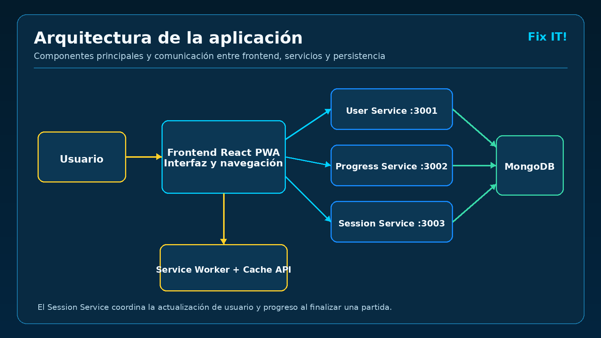
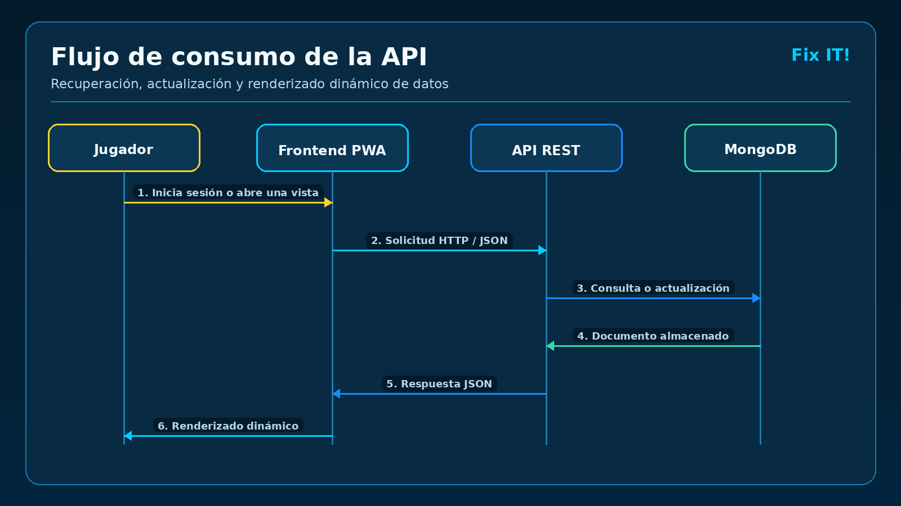
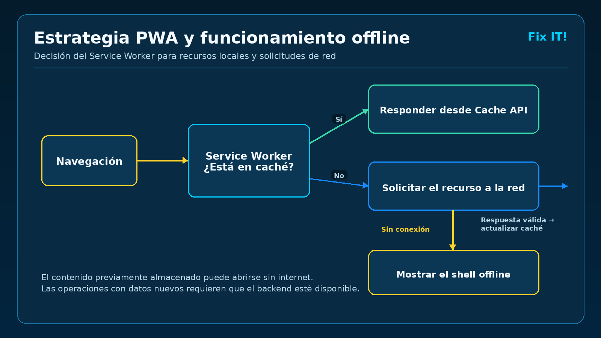
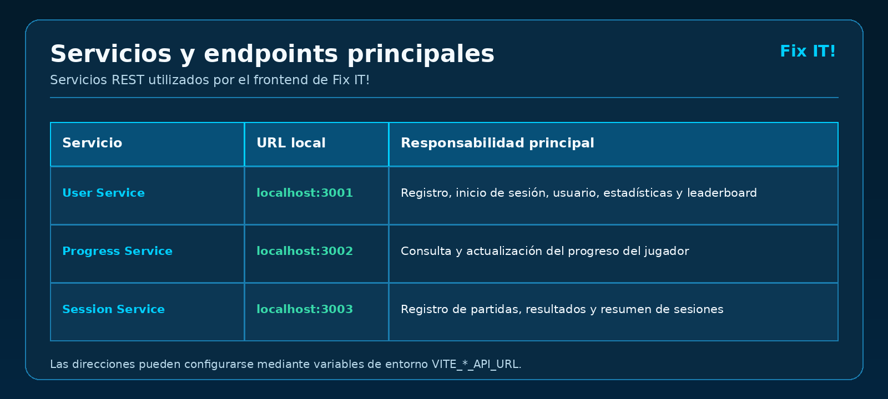

# Fix IT! — Proyecto Integrador PWA

Aplicación web progresiva orientada al aprendizaje de diagnóstico y reparación de computadoras mediante una experiencia de juego. El jugador completa reparaciones, obtiene puntuación y estrellas, acumula tiempo de juego y consulta su progreso, perfil y posición en el leaderboard.

## Objetivo académico

El proyecto presenta una propuesta completa de arquitectura e interfaz para una PWA que contempla:

| Requisito | Implementación en Fix IT! |
|---|---|
| Consumo de API | El frontend consume servicios REST para usuarios, progreso, sesiones, estadísticas y leaderboard. |
| Estrategia PWA | Manifiesto, Service Worker, caché del shell de la aplicación, funcionamiento básico sin conexión e instalación en Chrome/Edge. |
| UI/UX | Interfaz modular en React y CSS, navegación protegida, diseño responsivo y vistas diferenciadas. |
| Persistencia | MongoDB almacena usuarios, progreso y sesiones de juego. |

## Funcionalidades

- Registro e inicio de sesión de usuarios.
- Inicio con presentación del juego y llamada a comenzar una misión.
- Perfil con nivel, puntuación, tickets y tiempo jugado.
- Estadísticas y resumen de reparaciones.
- Leaderboard de jugadores.
- Registro y consulta del progreso y las sesiones.
- Instalación de la aplicación desde el navegador.
- Interfaz disponible sin conexión mediante caché; las operaciones que requieren datos nuevos necesitan acceso al backend.

## Tecnologías

### Frontend

- React 19
- Vite
- React Router
- JavaScript, JSX y CSS responsivo
- Web App Manifest
- Service Worker y Cache API

### Backend

- Node.js
- Express
- Mongoose
- Arquitectura basada en cuatro servicios REST independientes

### Base de datos

- MongoDB
- MongoDB Compass para inspección opcional

## Estructura del repositorio

```text
FIXIT-Proyecto-Integrador/
├── frontend/                   # Aplicación React y recursos PWA
│   ├── public/
│   │   ├── icons/
│   │   ├── manifest.json
│   │   └── sw.js
│   └── src/
│       ├── components/
│       ├── context/
│       ├── pages/
│       ├── services/
│       └── styles/
├── backend/
│   ├── user-service/           # Usuarios, autenticación y leaderboard
│   ├── progress-service/       # Progreso del jugador
│   ├── session-service/        # Sesiones y resultados de juego
│   └── news-service/           # Noticias del videojuego
├── docs/                       # Capturas y documentación adicional
├── .gitignore
└── README.md
```

## Arquitectura de la aplicación



La interfaz se comunica con los servicios mediante HTTP/JSON. Cada servicio tiene una responsabilidad definida y utiliza MongoDB para persistir la información. El Service Worker administra los recursos locales necesarios para abrir la interfaz sin conexión.

## Flujo de consumo de la API



## Estrategia PWA y funcionamiento offline



- `manifest.json` define nombre, colores, iconos, modo `standalone` y URL inicial.
- `sw.js` guarda el shell de la aplicación y recursos estáticos.
- `InstallPWA.jsx` captura el evento de instalación y muestra el botón correspondiente.
- Las llamadas a los puertos de la API no se almacenan como si fueran recursos estáticos, para evitar mostrar información desactualizada.
- Sin red es posible abrir y recorrer el contenido previamente almacenado. El registro, inicio de sesión y sincronización de datos requieren que MongoDB y los servicios del backend estén disponibles.

## Servicios y endpoints principales



> Las rutas exactas pueden consultarse en los archivos de rutas de cada servicio. Las URL del frontend son configurables mediante variables de entorno.

## Interfaz y experiencia de usuario

Las vistas principales están organizadas como módulos independientes:

- `/`: acceso y registro.
- `/home`: presentación del juego, contenido informativo y enlaces sociales.
- `/estadisticas`: métricas, progreso y reparaciones.
- `/leaderboard`: clasificación y búsqueda de jugadores.
- `/perfil`: información y progreso personal.

Las rutas privadas requieren un usuario autenticado. El diseño adapta sus tarjetas, navegación y contenido a diferentes tamaños de pantalla.

## Requisitos previos

- Node.js 20.19.0 o posterior para los microservicios del backend.
- npm.
- MongoDB ejecutándose localmente.
- Chrome o Edge para probar la instalación de la PWA.

## Despliegue del backend

El backend contiene cuatro servicios independientes y cuenta con un Blueprint para Render. Las instrucciones completas de variables, MongoDB Atlas, despliegue y verificación están en [backend/DEPLOYMENT.md](backend/DEPLOYMENT.md). Los endpoints de escritura actuales no tienen autorización; revisa la sección de seguridad antes de publicar datos reales.

## Configuración

### 1. Clonar el repositorio

```bash
git clone URL_DEL_REPOSITORIO
cd FIXIT-Proyecto-Integrador
```

### 2. Configurar User Service

```powershell
cd backend\user-service
npm install
Copy-Item .env.example .env
npm run seed
npm run dev
```

El comando `seed` crea datos de prueba. Solo es necesario ejecutarlo inicialmente o cuando se desee restablecer esa información.

### 3. Configurar Progress Service

En otra terminal:

```powershell
cd backend\progress-service
npm install
Copy-Item .env.example .env
npm run dev
```

### 4. Configurar Session Service

En otra terminal:

```powershell
cd backend\session-service
npm install
Copy-Item .env.example .env
npm run dev
```

### 5. Configurar News Service (si se requiere)

En otra terminal:

```powershell
cd backend\news-service
npm ci
Copy-Item .env.example .env
npm run dev
```

### 6. Ejecutar el frontend

En otra terminal, desde la raíz del proyecto:

```powershell
cd frontend
npm install
Copy-Item .env.example .env
npm run dev
```

Abrir `http://localhost:5173`.

## Variables de entorno

El frontend utiliza:

```env
VITE_USER_API_URL=http://localhost:3001
VITE_PROGRESS_API_URL=http://localhost:3002
VITE_SESSION_API_URL=http://localhost:3003
```

Los servicios del backend utilizan variables como `MONGO_URI`, `PORT` y `FRONTEND_URL`. Session Service también necesita las URL internas de User Service y Progress Service. Los valores de ejemplo están documentados en cada archivo `.env.example`.

Los archivos `.env` no deben subirse al repositorio. Únicamente se versionan los archivos `.env.example`, sin contraseñas ni secretos reales.

## Usuario de prueba

Después de ejecutar el seed:

```text
Correo: jugador1@fixit.com
Contraseña: Fixit123
```

## Instalación como aplicación

1. Iniciar frontend y backend.
2. Abrir `http://localhost:5173` en Chrome o Edge.
3. Pulsar **Instalar aplicación** o utilizar el icono de instalación de la barra de direcciones.
4. Confirmar la instalación.

En producción, la PWA debe publicarse mediante HTTPS para habilitar Service Workers e instalación. `localhost` se acepta durante el desarrollo.

## Evidencias sugeridas

Agregar en `docs/` capturas con nombres descriptivos, por ejemplo:

- `login.png`
- `inicio.png`
- `estadisticas.png`
- `leaderboard.png`
- `perfil.png`
- `pwa-instalada.png`
- `mongo-usuarios.png`

Después pueden insertarse en esta sección mediante Markdown.

### Seguridad y alcance actual del backend

User Service implementa registro y autenticación de usuarios mediante contraseñas protegidas con Argon2id. Durante el inicio de sesión se emiten tokens JWT firmados mediante HS256 y con tiempo de expiración configurable.

La validación de los JWT para autorizar solicitudes a endpoints protegidos constituye una fase posterior del desarrollo.

Las variables sensibles, como las cadenas de conexión a MongoDB y los secretos de firma, deben mantenerse fuera del repositorio mediante archivos `.env` excluidos del control de versiones.

Para un despliegue en producción se contempla implementar autorización de recursos, limitación de solicitudes, políticas CORS restringidas y conexiones HTTPS.
